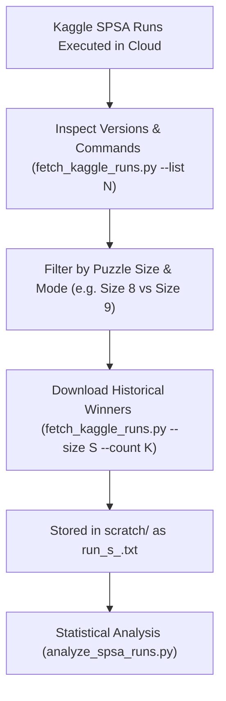

# Kaggle Kernel Runs & Artifact Downloader Guide

This skill documents how to inspect historical Kaggle notebook versions, resolve version discrepancies, and selectively download tuning artifacts (such as `*winners*.txt` files) directly into the `scratch/` directory as `.txt` files for multi-run statistical analysis.

---

## 1. Core Workflow



---

## 2. Key Kaggle API Nuances & Architecture

1. **Version Label Format**:
   - Kaggle's backend assigns a monotonic integer version (`currentVersionNumber`), but the API strictly requires the label formatted with a **`v` prefix** (`v665`, `v664`, etc.). Passing an unadorned integer (`665`) causes a `404 Not Found`.
2. **Kaggle CLI Limitation**:
   - The official CLI (`kaggle kernels output <kernel>/<version>`) parses the version string out of the argument but omits setting `version_label` in the underlying `ApiListKernelSessionOutputRequest`, always returning the latest output. The helper script bypasses this bug by setting `req.version_label = f"v{version_number}"` directly via the Python SDK.
3. **User Commit Names vs. API Metadata**:
   - Custom version commit titles entered in the Kaggle UI are not exposed in Kaggle's public `KernelsApiService` REST endpoints.
   - However, each version's **exact notebook cell code**, **execution timestamp**, and **output files** can be queried directly via `client.kernels.kernels_api_client.get_kernel` and `list_kernel_session_output`.
4. **Pagination Required for Repository Outputs**:
   - Notebook runs that clone the git repository produce 400+ output files. Because Kaggle paginates output listings (max 200 items per page), scripts must follow `next_page_token` to reach files stored in `scratch/`.
5. **Strict File Naming**:
   - All downloaded runs are saved directly as `.txt` files in `scratch/` (e.g. `scratch/run_s8_00.txt`, `scratch/run_s9_00.txt`) without symlinks, ensuring full compatibility with downstream globbing in `analyze_spsa_runs.py`.
6. **Execution Environment**:
   - Kaggle SDK requires the `default` micromamba environment with network access enabled:
     ```bash
     micromamba run -n default python3 python_scripts/fetch_kaggle_runs.py ...
     ```

---

## 3. Graceful Handling of Variations (`fetch_kaggle_runs.py`)

The helper script `python_scripts/fetch_kaggle_runs.py` is designed to handle variable run requirements flexibly:

### A. Automatic Size-Aware Run Discovery
Instead of manually calculating Kaggle version numbers, specify the puzzle size and the desired number of runs. The script scans backwards from the latest version, finds matching runs, and numbers them chronologically:

```bash
# Automatically fetch the last 10 Size-8 runs -> scratch/run_s8_00.txt .. run_s8_09.txt
micromamba run -n default python3 python_scripts/fetch_kaggle_runs.py --size 8 --count 10

# Automatically fetch the last 15 Size-9 runs -> scratch/run_s9_00.txt .. run_s9_14.txt
micromamba run -n default python3 python_scripts/fetch_kaggle_runs.py --size 9 --count 15

# Fetch any custom count (e.g. 5, 20, 25 runs)
micromamba run -n default python3 python_scripts/fetch_kaggle_runs.py --size 9 --count 25
```

### B. Inspect Recent Versions & Tuning Configurations
Inspect recent runs to check command line parameters, puzzle sizes, and timestamps:

```bash
micromamba run -n default python3 python_scripts/fetch_kaggle_runs.py --list 30
```

### C. Explicit Version Range or List
When specific version numbers are needed:

```bash
# Explicit range of versions:
micromamba run -n default python3 python_scripts/fetch_kaggle_runs.py \
    --versions 656..665 --filter "*winner*.txt" --dest "scratch/run_s8_{index:02d}.txt"

# Specific comma-separated versions:
micromamba run -n default python3 python_scripts/fetch_kaggle_runs.py \
    --versions 665,660,650 --filter "*winner*.txt" --dest "scratch/run_s8_{index:02d}.txt"
```

> [!TIP]
> The destination filename template supports `{index}`, `{size}`, `{version}`, and `{filename}` placeholders. If the `.txt` extension is omitted, the tool automatically appends `.txt`.

---

## 4. Downstream Analysis Pipeline

Once run files are saved to `scratch/`, proceed with standard SPSA statistical analysis:

```bash
# Analyze Size 8 runs
python3 python_scripts/analyze_spsa_runs.py --size 8 scratch/run_s8_*.txt

# Analyze Size 9 runs
python3 python_scripts/analyze_spsa_runs.py --size 9 scratch/run_s9_*.txt
```
